# Project Astra

*Radio telescope replication guide*

Contents

- [Build the reflector](#build-the-reflector)
- [Assemble the reflector sectors](#assemble-the-reflector-sectors)
- [Build the tripod](#build-the-tripod)
- [Build and reinforce the rotator](#build-and-reinforce-the-rotator)
- [Build the feedhorn](#build-the-feedhorn)
- [Position and support the feedhorn](#position-and-support-the-feedhorn)
- [Connect the receiver chain](#connect-the-receiver-chain)
- [Configure the rotator controller](#configure-the-rotator-controller)
- [Set up the spectrometer](#set-up-the-spectrometer)
- [Calibrate and collect observations](#calibrate-and-collect-observations)
- [First field test](#first-field-test)
- [First field test observations and failures](#first-field-test-observations-and-failures)
- [Interpret the original observation](#interpret-the-original-observation)
- [Parts list for the original build](#parts-list-for-the-original-build)
- [Fasteners and small hardware](#fasteners-and-small-hardware)
- [Build files and technical references](#build-files-and-technical-references)

Build a one metre dish telescope for observations near the 1420.4058 MHz neutral hydrogen line. This guide covers the reflector, feedhorn, tripod, rotator, receiver chain, and software checks.

The original prototype collected spectra, but did not confirm an astronomical hydrogen line. Its rotator also suffered mechanical failures. Treat the dimensions as a starting design and complete the checks in this guide before relying on observations.

The dish has eight printed sectors coated with aluminium tape. A pyramidal feedhorn sits near the focus. A filtered low noise amplifier (LNA) feeds an RTL-SDR receiver, and GNU Radio processes the samples.

  <a href="images/project-astra/01-the-assembled-reflector-and-feedhorn-mounted-on-the-tripod-and-ro.png">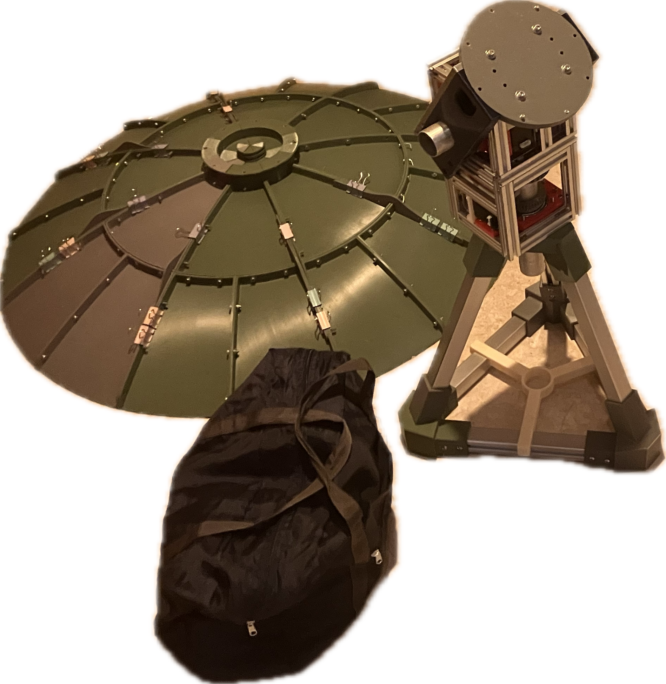</a>

*The assembled reflector and feedhorn mounted on the tripod and rotator.*

Before starting, obtain matching CAD or STL files for the printed parts, the rotator firmware and configuration, and a working spectrometer flowgraph. Check their revisions together before printing a complete set.

## Build the reflector

| Parameter | Value |
| --- | --- |
| Diameter | 1000 mm |
| Focal length to diameter ratio | 0.4 |
| Focal length from the dish vertex | 400 mm |
| Calculated centre depth | 156.25 mm |
| Printed sectors | 8 |
| Reflective surface | Aluminium tape over printed ABS |

Print the eight sectors from one matching revision. Dry fit them before coating or final fastening. Align the joints so that the assembled face follows a continuous parabola. Apply aluminium tape across each sector with electrically continuous overlaps and as few wrinkles as practical.

  <a href="images/project-astra/02-left-reflective-face-right-rear-structure-and-radial-ribs.png">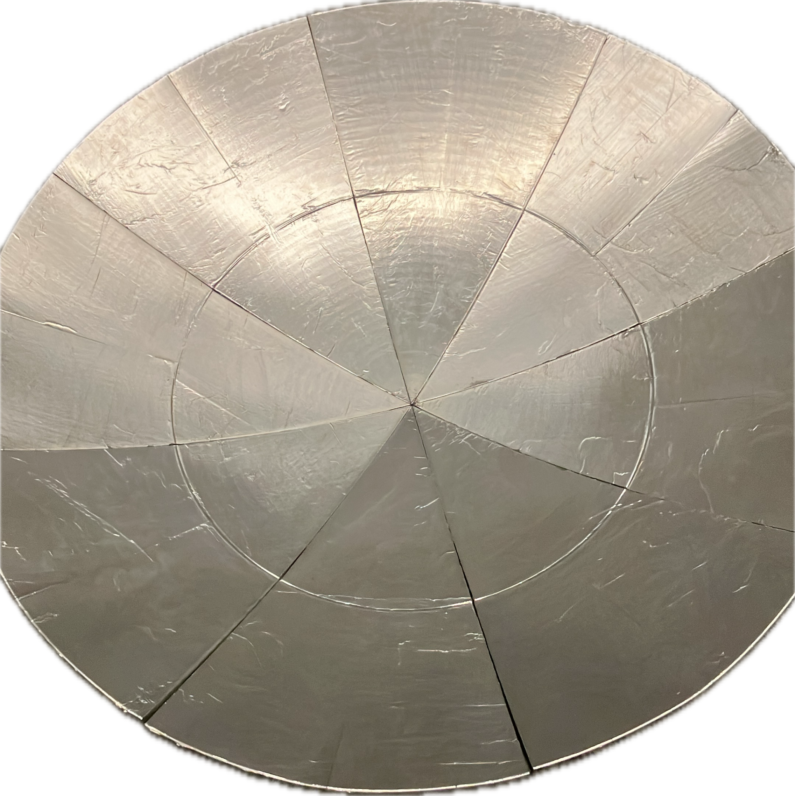</a>
  <a href="images/project-astra/03-left-reflective-face-right-rear-structure-and-radial-ribs.png">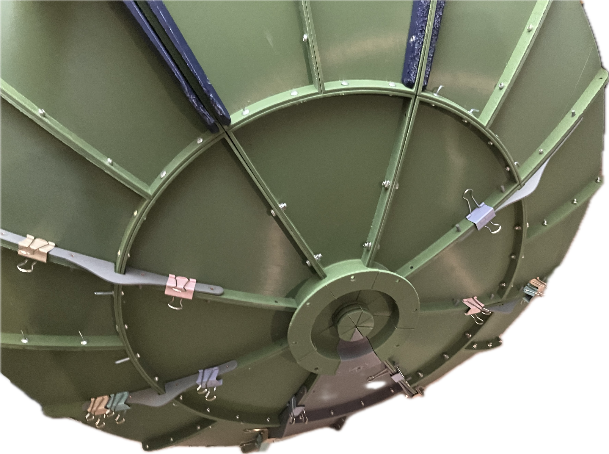</a>

*Left: reflective face. Right: rear structure and radial ribs.*

The nominal focus is 400 mm from the deepest point along the dish axis. Place the feedhorn phase centre near this point; the phase centre is not necessarily the copper probe or the horn mouth. Its final position needs adjustment and measurement.

The original design estimated about 21 dBi gain with 60 percent aperture efficiency and about 14.8 degrees half power beamwidth. These are design estimates, not measured performance.

## Assemble the reflector sectors

The radial ribs join the sectors and reduce the number of fasteners needed during transport. The prototype used M2.5 copper fasteners at the rib connections. Inspect these joints before lifting or mounting the dish.

  <a href="images/project-astra/04-left-one-sector-and-its-rear-support-right-a-fitted-radial-rib.jpg">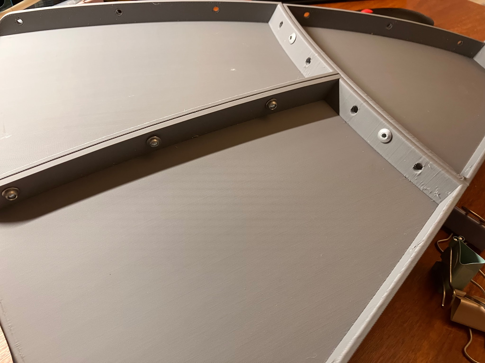</a>
  <a href="images/project-astra/05-left-one-sector-and-its-rear-support-right-a-fitted-radial-rib.jpg">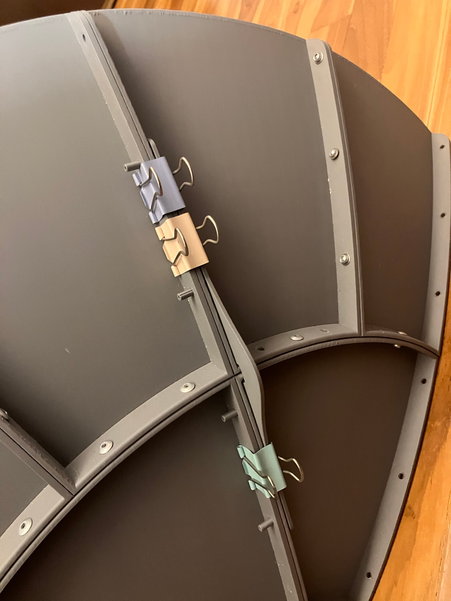</a>

*Left: one sector and its rear support. Right: a fitted radial rib.*

Check each sector for cracks, warped edges, loose fasteners, and gaps in the reflective coating. Support the dish while fastening it to the mount so that the load does not hang from one joint.

  <a href="images/project-astra/06-rear-mounting-area-and-the-connections-between-the-reflector-and.png">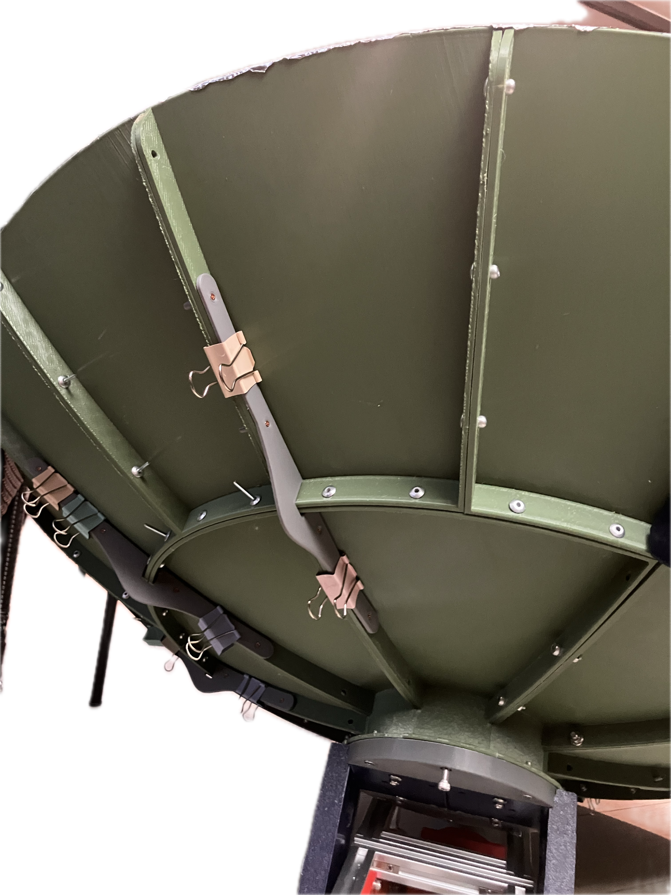</a>

*Rear mounting area and the connections between the reflector and support structure.*

Keep space for an Allen key or screwdriver beneath the dish plate. The first field assembly was slowed by inaccessible screws. Test tool access with the dish, feedhorn, and rotator fully assembled.

## Build the tripod

The tripod uses six 30 by 30 mm aluminium profiles, each 350 mm long, arranged as a triangular base and three sloping supports. Printed side brackets, a top hub, and an aligner hold the profiles together. Use the version 8 parts as the reference set.

  <a href="images/project-astra/07-left-tripod-cad-arrangement-right-assembled-tripod-with-its-lower.png">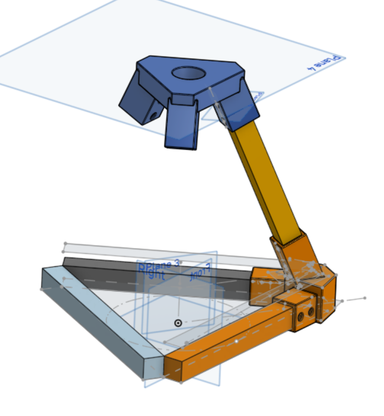</a>
  <a href="images/project-astra/08-left-tripod-cad-arrangement-right-assembled-tripod-with-its-lower.png">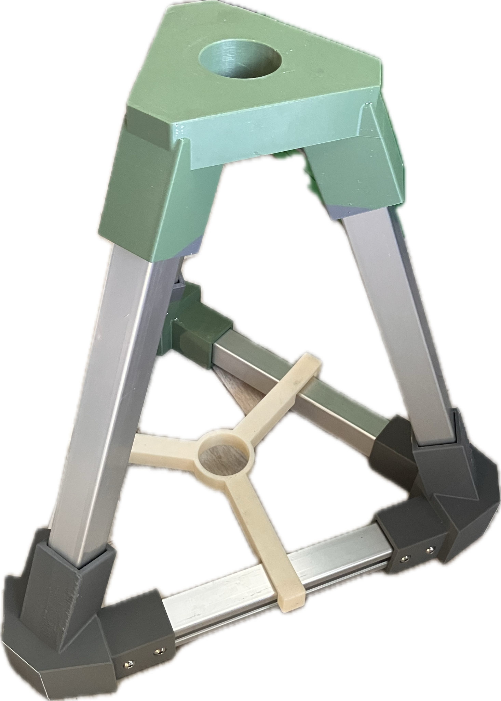</a>

*Left: tripod CAD arrangement. Right: assembled tripod with its lower aligner.*

The revised brackets use wider supports, a longer fastening region with two screw positions, and complete square feet. Earlier thin brackets and short aligners broke or detached under load.

The top hub has a 46 mm opening and a replaceable collar to fit the central pipe. This lets you change the fit by replacing the collar rather than reprinting the hub.

  <a href="images/project-astra/09-left-replaceable-pipe-collar-right-the-aligner-joining-the-base-p.png">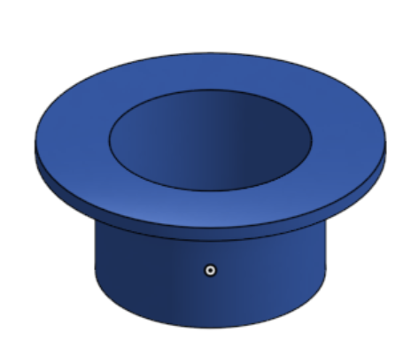</a>
  <a href="images/project-astra/10-left-replaceable-pipe-collar-right-the-aligner-joining-the-base-p.png">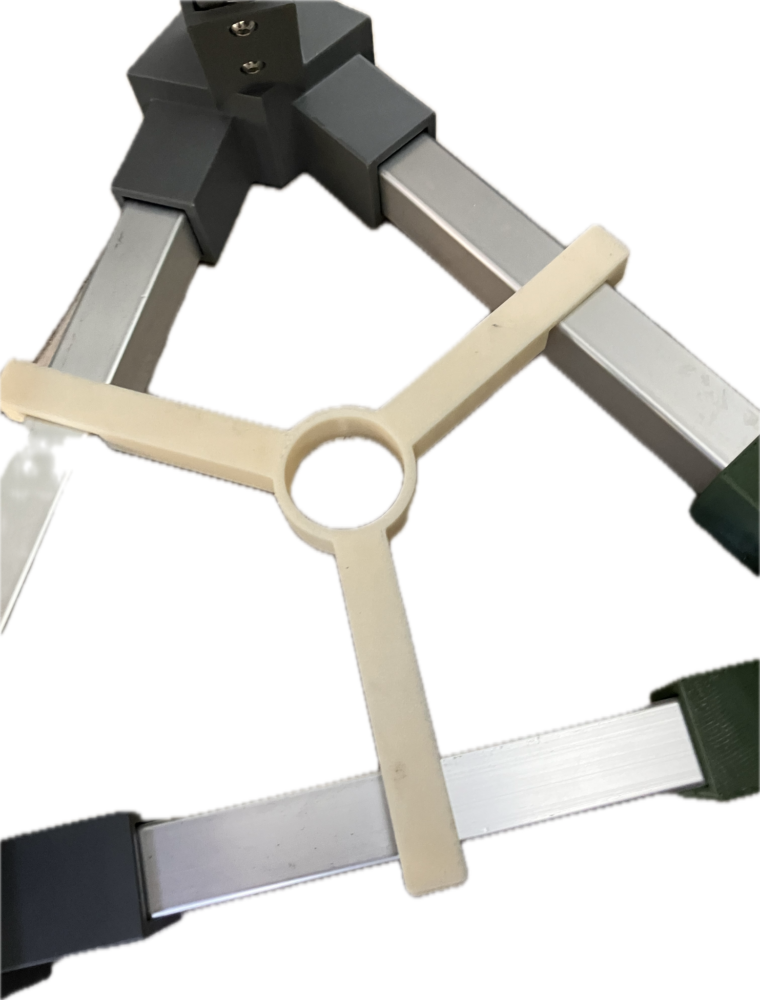</a>

*Left: replaceable pipe collar. Right: the aligner joining the base profiles.*

Dry fit the pipe, collar, bearings, and printed parts before assembly. Add ballast or sandbags at the base as needed, then check for rocking, lateral movement, and loose profile screws under the assembled telescope load.

## Build and reinforce the rotator

The mount follows the SatNOGS Rotator v3 design. The lower module turns azimuth and the upper module turns elevation. Each axis uses a NEMA 17 motor, a GT2 belt stage, and a worm drive.

  <a href="images/project-astra/11-two-axis-rotator-assembly-before-mounting-the-dish.jpg">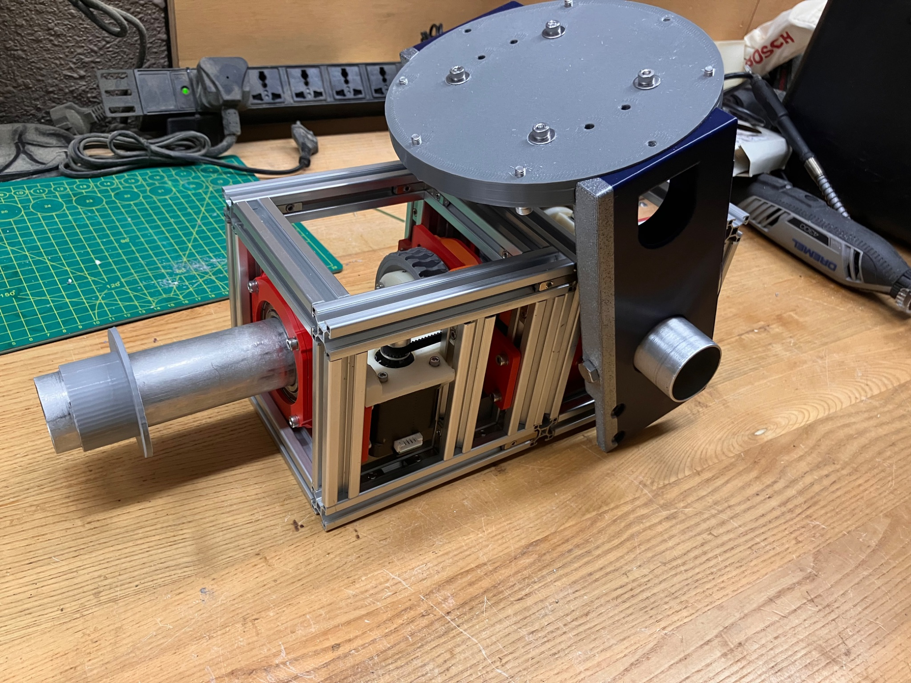</a>

*Two axis rotator assembly before mounting the dish.*

| Drive parameter | Original specification |
| --- | --- |
| Motor | 17HS8401S NEMA 17 |
| Motor holding torque | 0.52 Nm |
| Motor and worm pulleys | 20 and 36 teeth |
| Worm and wheel | One start worm and 30 tooth wheel |
| Combined nominal reduction | 54 to 1 |

The ideal holding torque estimate is 28.08 Nm before losses. This calculation does not establish running torque, printed gear strength, or wind capacity. The original mount failed under load despite the favourable torque estimate.

Reinforce pipe connections with the documented M8 fastening modification; the original set screws allowed parts to slip. Fit and secure the worm shaft nuts and check the assembly for movement under load.

  <a href="images/project-astra/12-the-modified-fastening-areas-secure-the-rotator-components-to-the.png">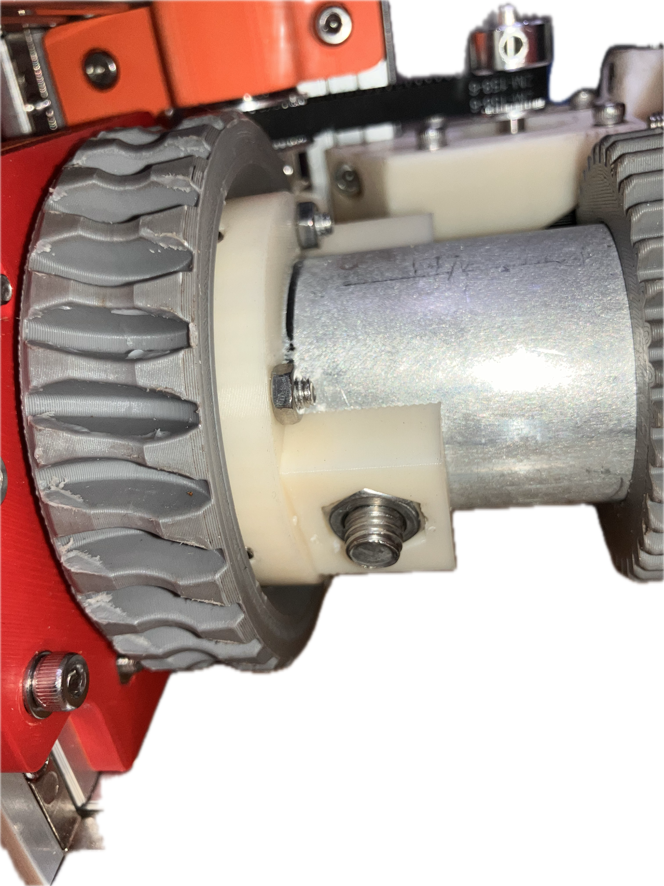</a>
  <a href="images/project-astra/13-the-modified-fastening-areas-secure-the-rotator-components-to-the.png">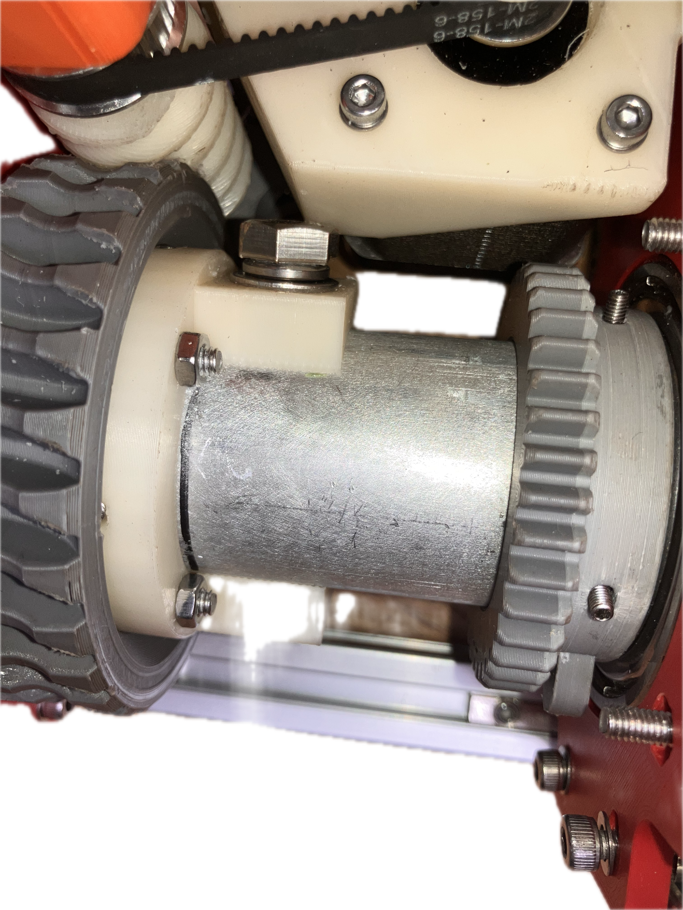</a>

*The modified fastening areas secure the rotator components to their pipes.*

## Build the feedhorn

The feed is a printed pyramidal horn with a WR-650 rectangular waveguide section and an aluminium tape lining. Use the following internal dimensions as the original build reference.

| Dimension | Value in mm |
| --- | --- |
| Waveguide width | 165.1 |
| Waveguide height | 82.55 |
| Waveguide length | 90 |
| Horn mouth width | 199 |
| Horn mouth height | 167 |
| Flare axial length | 211.1 |
| Probe distance from the back wall | 34.3 |
| Nominal probe length | 52.75 |

Place the copper probe at the centre of the broad waveguide dimension. It connects to the N-type panel mount. The parts list describes a roughly 50 mm pin; the dimensional design specifies 52.75 mm, so verify the actual probe length and exposed length during assembly.

  <a href="images/project-astra/14-left-lined-horn-interior-and-probe-right-horn-exterior-with-stiff.jpg">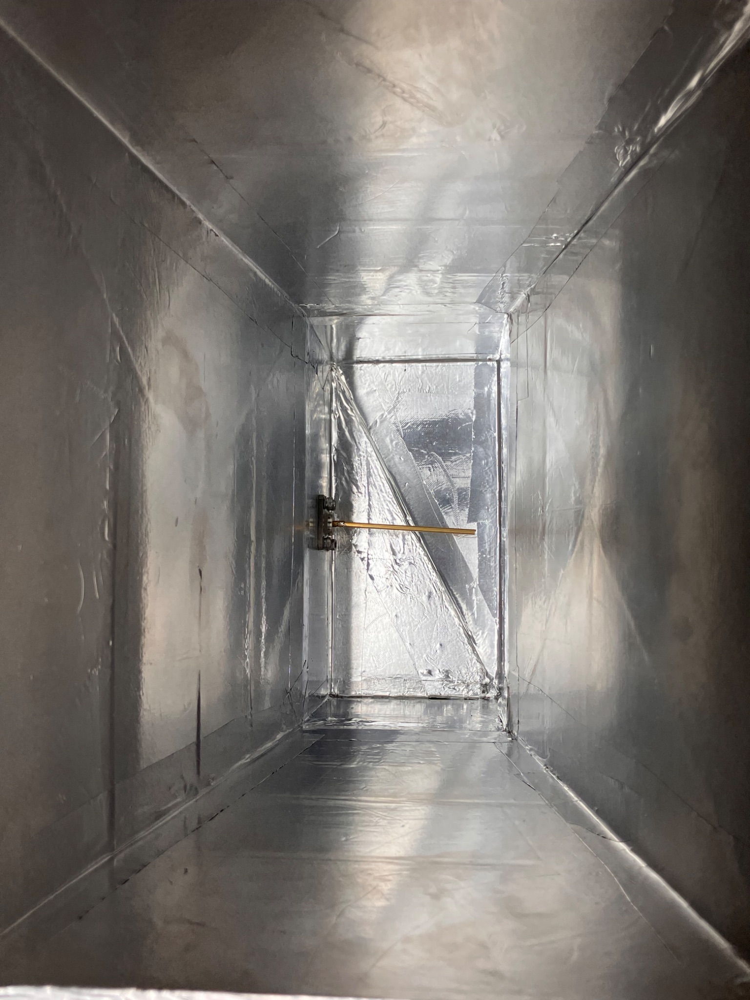</a>
  <a href="images/project-astra/15-left-lined-horn-interior-and-probe-right-horn-exterior-with-stiff.png">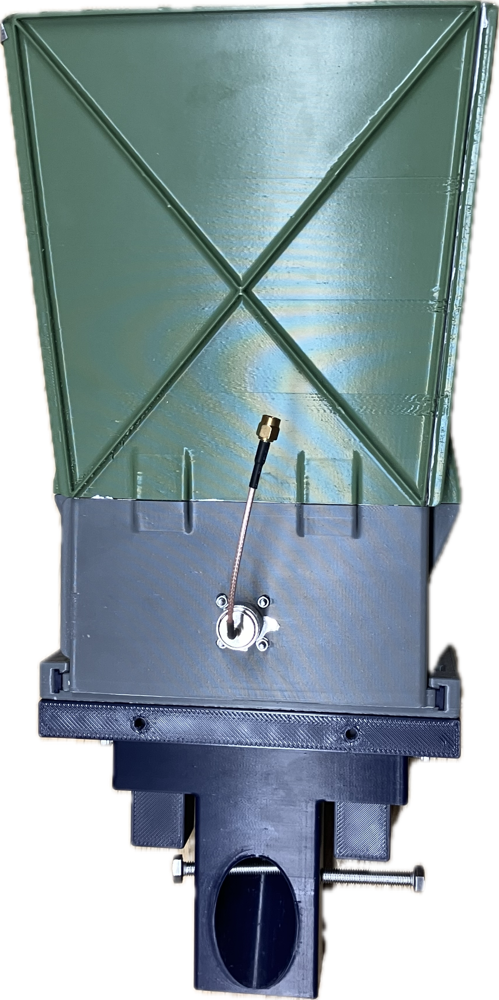</a>

*Left: lined horn interior and probe. Right: horn exterior with stiffening ribs.*

The WR-650 section has a dominant mode cutoff near 908 MHz and supports the intended 1420 MHz operation. The horn was designed for roughly 10 dB edge taper, but its illumination and impedance were not measured.

## Position and support the feedhorn

Keep the horn centred on the dish axis and facing the reflector. Start near the nominal focus, then adjust its position in small steps while measuring a repeatable source. Move one axis at a time and record each position. Keep receiver gain and processing settings unchanged during comparisons.

  <a href="images/project-astra/16-the-slotted-mount-permits-adjustment-of-the-horn-relative-to-the.png">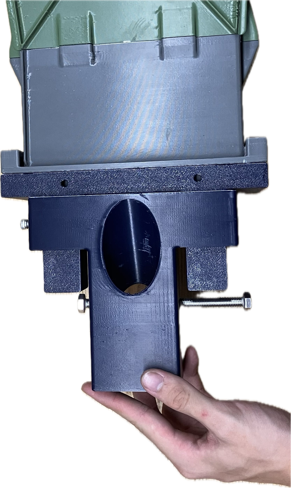</a>
  <a href="images/project-astra/17-the-slotted-mount-permits-adjustment-of-the-horn-relative-to-the.png">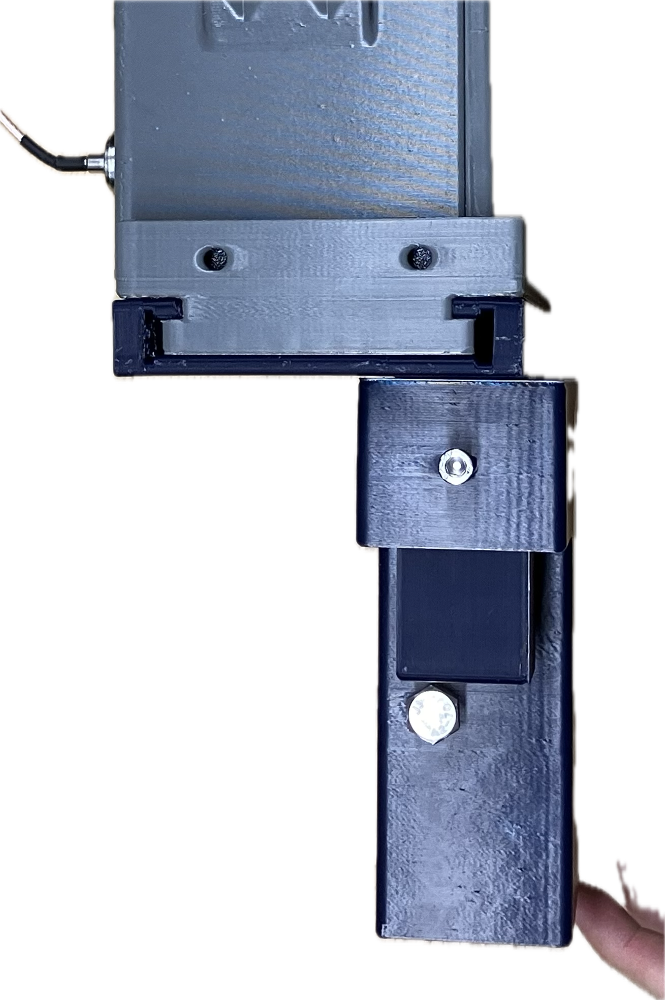</a>

*The slotted mount permits adjustment of the horn relative to the dish.*

The original mount permits movement along three axes but has limited angular adjustment. Support the horn so that its weight does not tilt it or pull the mount out of alignment.

Retain the stiffening ribs in the printed horn. A version without sufficient support warped during printing and cooling, changing the intended geometry.

  <a href="images/project-astra/18-warping-seen-in-an-earlier-horn-without-sufficient-stiffening.png">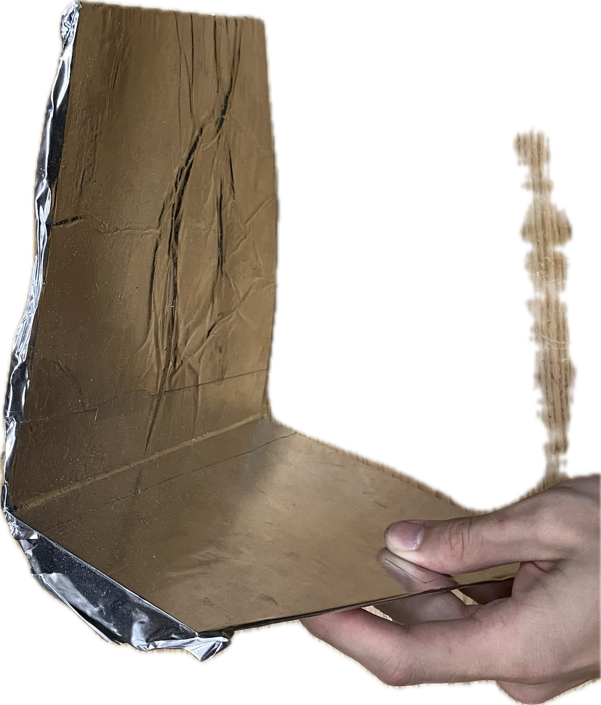</a>

*Warping seen in an earlier horn without sufficient stiffening.*

Line the waveguide, flare, and back wall continuously with conductive aluminium tape. Inspect seams and ensure the probe is not shorted to the opposite wall. Recheck alignment after transport.

## Connect the receiver chain

Connect the RF path in this order: copper probe and N-type panel mount, N-type to SMA adapter, filtered LNA input, LNA output, coax, and RTL-SDR antenna connector. Connect the SDR to the computer over USB.

| Component | Original build specification |
| --- | --- |
| Filtered LNA | 1380 to 1460 MHz passband; nominal 18 dB gain; noise figure no more than 1 dB |
| LNA power | External 5 V USB-C supply |
| Coax | RG174, nominal 50 ohms |
| Receiver | RTL2832U dongle labelled RTL-SDR V2 in the original build |

Check the LNA IN and OUT labels before connecting. Keep the cable between the feed and LNA short. Cable loss at 1420 MHz matters even when DC continuity is good. Verify the LNA manufacturer's power and DC isolation requirements before connecting an external supply or enabling an SDR bias tee.

  <a href="images/project-astra/19-left-probe-connector-and-adapter-centre-combined-lna-and-filter-r.jpg">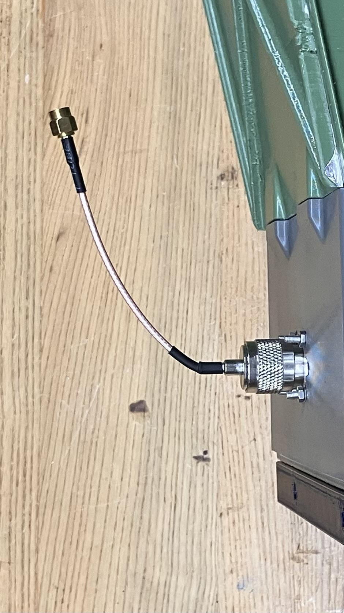</a>
  <a href="images/project-astra/20-left-probe-connector-and-adapter-centre-combined-lna-and-filter-r.png">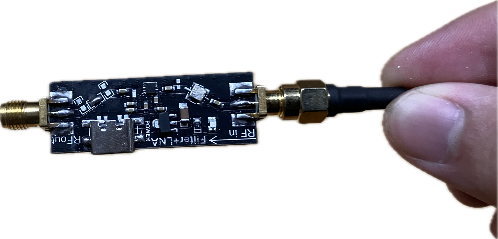</a>
  <a href="images/project-astra/21-left-probe-connector-and-adapter-centre-combined-lna-and-filter-r.png">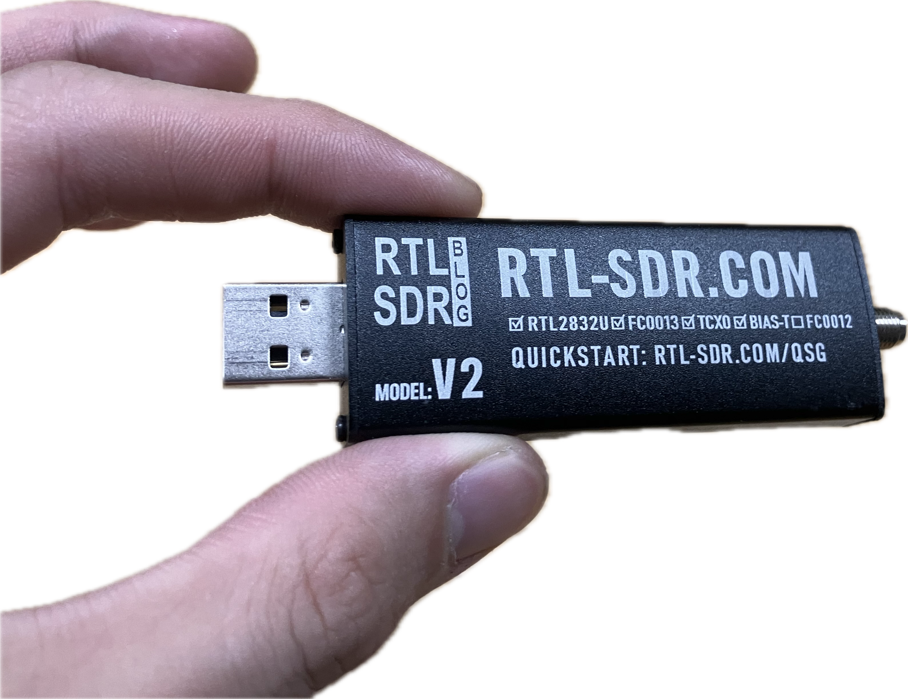</a>

*Left: probe connector and adapter. Centre: combined LNA and filter. Right: original SDR receiver.*

Before mounting everything, test the receiver and LNA with a short coax connection. Use fixed manual SDR gain, disable AGC, and compare the uncalibrated spectrum with the LNA powered and physically bypassed. A noise increase suggests activity but does not measure gain or prove better sensitivity.

The original receiver noise estimate was about 89 K with the nominal LNA specifications, versus about 865 K for a 6 dB noise figure SDR alone. These estimates exclude coax loss, antenna noise, and other system losses; they were not verified measurements.

## Configure the rotator controller

The prototype used an MKS SBASE v1.3 board as the combined controller and motor driver. A computer sent G-code over USB serial to firmware already present on the reused board. Confirm the installed firmware and command set before using this approach with another board.

  <a href="images/project-astra/22-mks-sbase-v13-controller-and-driver-board.png">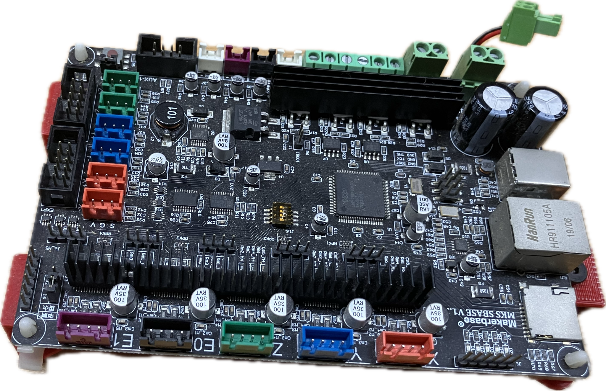</a>

*MKS SBASE v1.3 controller and driver board.*

The control interface sends movement commands and converts commanded motion into azimuth and elevation. Calibrate the conversion by measuring physical motion on each axis. Include the motor step angle, microstepping, pulley reduction, and worm reduction; the mechanical ratio alone is not the complete command conversion.

  <a href="images/project-astra/23-original-rotator-control-interface.png">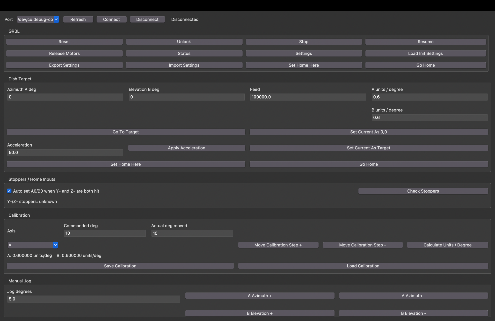</a>

*Original rotator control interface.*

Test direction, end stops, homing, travel limits, and small movements without the dish attached. Repeat with the mounted load only after checking balance and clearances. Record angle and time if you intend to compare pointing with recorded RF power.

Use a regulated supply suitable for the actual board and motors. A vehicle outlet measured 14.6 V during the first test and the motors did not run. Operation resumed with another supply; the exact fault mechanism was not established.

## Set up the spectrometer

GNU Radio Companion generates the Python program that reads SDR samples, forms frequency spectra, averages power, and applies calibration. Use a flowgraph version compatible with the installed GNU Radio and DSPIRA blocks.

The original Astra flowgraph replaced DSPIRA's four branch polyphase processing with a direct FFT and a Blackman-Harris window. In that version, keep the FFT window: removing the polyphase stage while retaining a rectangular window changes spectral leakage.

  <a href="images/project-astra/24-original-astra-flowgraph-showing-the-direct-fft-processing-chain.png">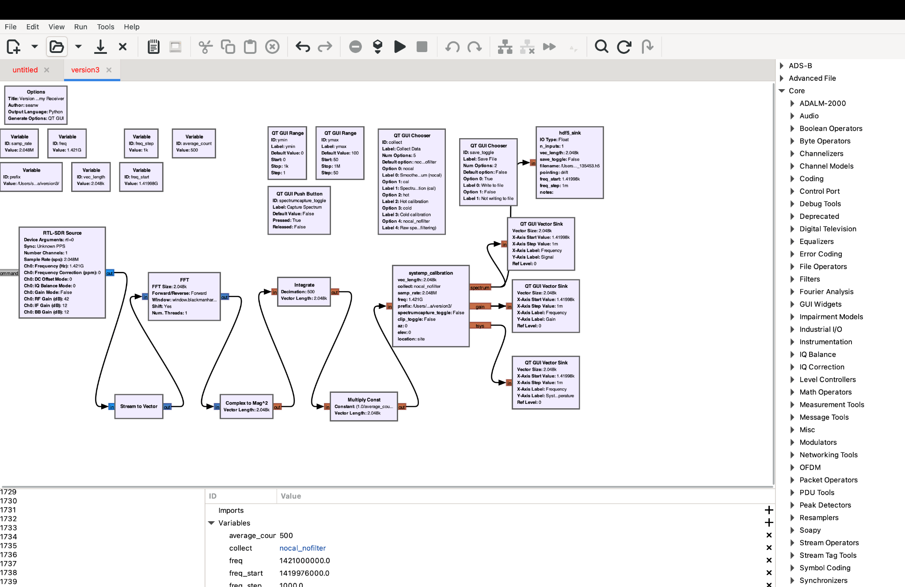</a>

*Original Astra flowgraph showing the direct FFT processing chain.*

For the current DSPIRA flowgraph, configure the source for the actual receiver. A useful RTL-SDR starting point is 2.4 MS/s and a centre frequency near 1420 or 1420.5 MHz. Confirm that 1420.4058 MHz is comfortably inside the sampled band and away from the centre artefact.

Calculate the frequency axis from the actual centre frequency, sample rate, and FFT length. Keep AGC off for power measurements. Set an existing output folder and confirm that saved spectra reopen with the expected frequencies, units, and timestamps.

Begin with unfiltered, uncalibrated output and short integration for hardware checks. Use longer integration for sky measurements. Keep one saved configuration for each observation and record any changes to gain, frequency, sample rate, or cabling.

## Calibrate and collect observations

Warm up the receiver and amplifier before calibration. Keep gain, cable routing, feed position, and integration settings stable. Hot and cold references estimate the system response and convert power into equivalent antenna temperature.

1. Point the assembled telescope at the ground for the hot reference. Use a clear ground view or a suitable RF absorber that fills the beam. The original software assumes a 300 K hot reference.

2. Select Hot calibration and long integration. Wait until the spectrum settles, then leave that mode before moving the telescope so the reference is preserved.

3. Point at open sky away from strong hydrogen emission, the Sun, buildings, and the horizon. Leave the feed uncovered. Aluminium foil is reflective and is not a cold calibration load.

4. Collect the cold reference with long integration. The original software assumes 10 K; this is a model value and may not match the actual sky and ground spillover.

5. Switch to Spectrum with calibration before moving to the target. Inspect the baseline and system temperature for implausible values or drift.

6. Save the spectrum, pointing direction, time, integration duration, receiver gain, and hardware configuration. Repeat calibration after changes to the RF chain or gain.

A smoother graph alone does not demonstrate correct calibration or hydrogen detection. Compare raw, hot, cold, and calibrated spectra, and retain all four for later analysis.

### Check the beamwidth

After obtaining a repeatable source measurement, scan across it while logging angle and time. Subtract the background in linear power, locate half the excess peak power on each side, and subtract the two angles. This estimates the full half power beamwidth. The original design predicted about 14.8 degrees; a measurement is needed to establish the actual value.

## First field test

2 August at 23:00 to 3 August at 04:00     East Coast Park

We chose a carpark with enough space to assemble the telescope and an open view of the sky. This first test exposed problems with the mount, power supply, and calibration setup that were difficult to identify on the workbench.

### Before leaving

The PLA connector between the tripod and rotator broke before deployment. Its grip on the tube was also inadequate. We inserted the rotator directly into the tripod instead, which proved more stable during setup. This became the preferred direction for the next mounting revision.

  <a href="images/project-astra/25-the-temporary-arrangement-placed-the-rotator-directly-into-the-tr.png">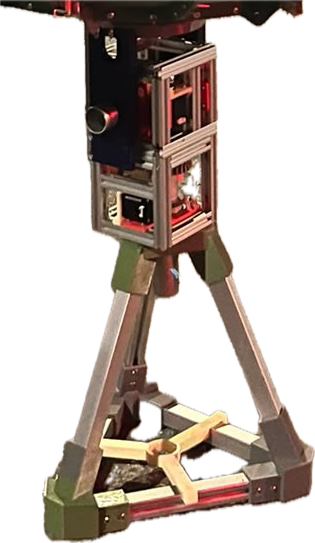</a>

*The temporary arrangement placed the rotator directly into the tripod.*

### Assembly on site

Most of the assembly went smoothly, but the dish plate left too little room for a screwdriver. An Allen key worked, although fastening was slow. Installing the feedhorn was also awkward: a locating clip that holds it in place before tightening the screws would make assembly easier.

### Power problems

The vehicle outlet was expected to supply 12 V but measured 14.6 V. The SBASE controller did not drive the motors. Testing again at home pointed to a supply-related problem; we did not establish whether a protection circuit was responsible.

The LNA also failed to power from the original power bank cable. It required an external 5 V USB-C supply. Changing to a separate USB cable resolved that test. The cause of the cable or power bank incompatibility was not confirmed, so the exact field power arrangement needs testing before deployment.

## First field test observations and failures

### Observing by hand

Without motor control, the telescope was difficult to manoeuvre. We had no RF absorber for the hot reference and pointed at nearby bushes instead. That was an improvised reference, not a validated calibration load. We then pointed approximately northwest at 30 degrees elevation, chosen using Stellarium, and recorded spectra.

  <a href="images/project-astra/26-assembling-and-adjusting-the-telescope-during-the-overnight-field.jpg">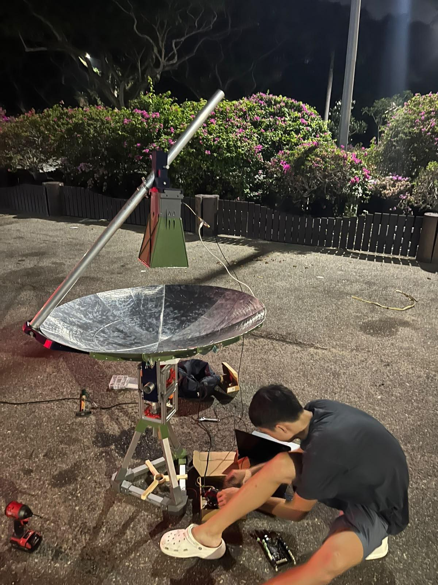</a>
  <a href="images/project-astra/27-assembling-and-adjusting-the-telescope-during-the-overnight-field.jpg">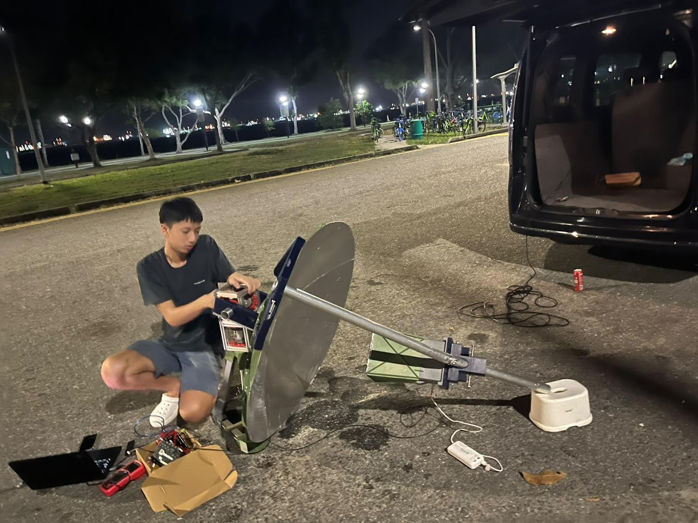</a>

*Assembling and adjusting the telescope during the overnight field session.*

### Mount movement and damage

The red dish plate was not secured rigidly to the rotator. We proposed replacing the original surface fastening with longer M5 bolts into the aluminium profile. The test also showed the need for a counterweight: the calculated gear reduction did not compensate for weak mechanical joints.

The printed worm drive broke under the dish load. Two nuts below the worm were also loose, allowing the motor to turn without reliably driving the output. These failures need separate fixes: stronger, balanced load paths and a correctly secured shaft assembly.

  <a href="images/project-astra/28-left-failed-worm-drive-centre-worm-shaft-hardware-right-the-plate.jpg">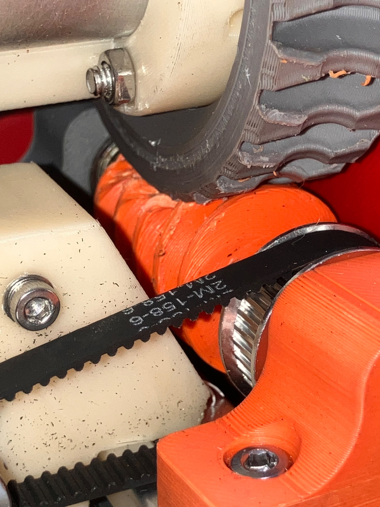</a>
  <a href="images/project-astra/29-left-failed-worm-drive-centre-worm-shaft-hardware-right-the-plate.jpg">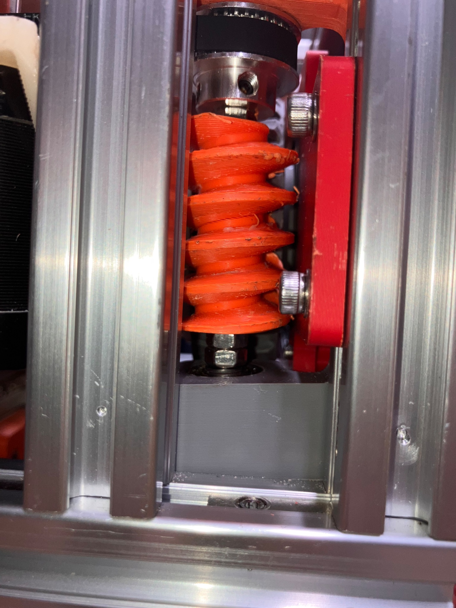</a>
  <a href="images/project-astra/30-left-failed-worm-drive-centre-worm-shaft-hardware-right-the-plate.png">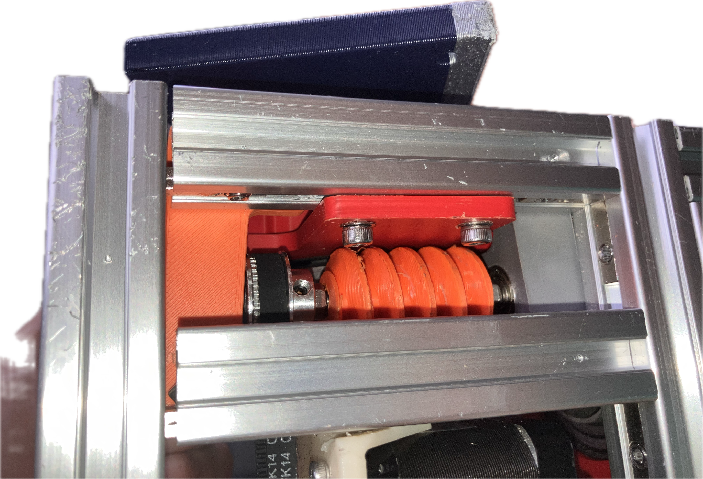</a>

*Left: failed worm drive. Centre: worm shaft hardware. Right: the plate and profile connection.*

### Changes before the next test

Load test the revised plate and pipe connections, balance the dish, and check every shaft nut, clamp, and belt. Confirm tool access and test the complete power and recording setup before transporting it. The results of this session are discussed in the following section.

A separate fit problem also damaged a bearing: the nominal 40 mm pipe was too tight. A 39.5 mm pipe was proposed for that particular assembly. Measure the actual bearing and pipe tolerances and trial fit one joint before ordering the rest.

## Interpret the original observation

The first field test produced saved spectra, but no confirmed hydrogen detection. The plots below show why the receiver response and calibration needed further investigation.

The raw spectrum contained a prominent narrow feature near 1421 MHz, which was also the receiver's tuning centre. It was treated as a likely instrumental centre spike rather than an astronomical detection.

  <a href="images/project-astra/31-original-relative-power-spectrum-with-its-dominant-feature-near-1.png">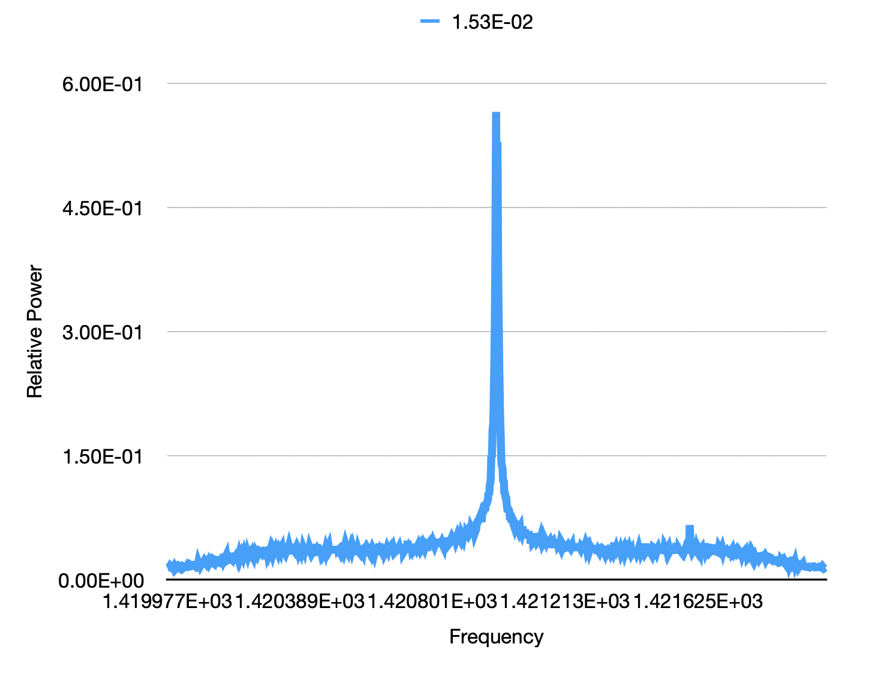</a>

*Original relative power spectrum with its dominant feature near 1421 MHz.*

The later calibration display showed no confirmed feature near 1420.4 MHz. Absolute calibration was not fully validated, so the reported data remain a non-detection.

  <a href="images/project-astra/32-original-display-after-calibration-retained-as-a-troubleshooting.png">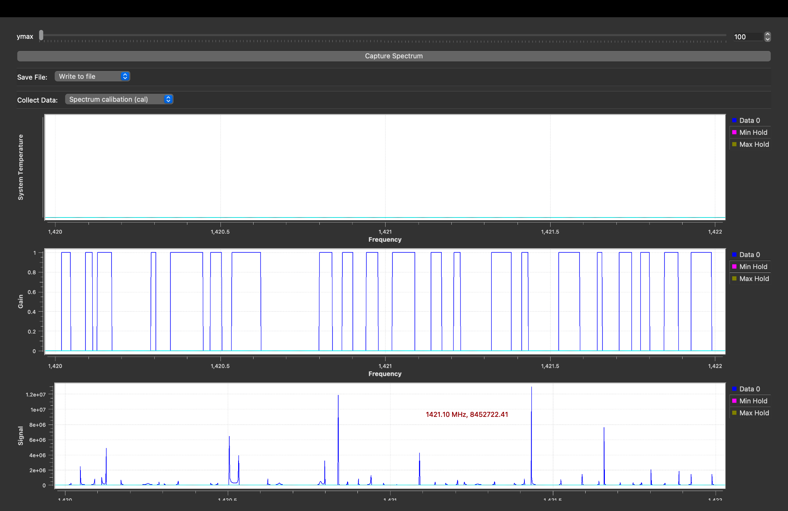</a>

*Original display after calibration, retained as a troubleshooting example.*

Before claiming hydrogen detection, repeat observations, retain an off-source comparison, and change the receiver centre frequency to check whether a feature stays at the same RF frequency or follows the tuning centre. Receiver artefacts and local interference need to be excluded.

## Parts list for the original build

The recorded total was RMB 1582.96, approximately SGD 300.71 as tallied on 3 August. It includes shipping and miscellaneous costs and is a historical build tally, not a current quotation. Purchase quantities exceeded the quantities used for several items.

| Main component | Quantity used | Specification |
| --- | --- | --- |
| Tripod profiles | 6 | 30 by 30 mm, length 350 mm |
| Rotator profiles | 18 and 8 | 20 by 20 mm; lengths 100 and 140 mm |
| Aluminium tube | 3 m | Trial fit to bearings and printed parts |
| 625 ZZ bearings | 4 | Rotator bearings |
| 6008 ZZ bearings | 4 | Rotator bearings |
| Stepper motors | 2 | HANPOSE 17HS8401S NEMA 17 |
| GT2 pulleys | 2 each | 20 tooth and 36 tooth; 5 mm bore, 6 mm belt |
| GT2 belts | 2 | 6 mm width, 158 mm length, 79 teeth |
| Profile brackets | 40 | Inner bracket, B type slot 6 |
| End stop switches | 2 | Verify with controller firmware |
| Controller and driver | 1 | MKS SBASE v1.3 |
| N-type panel mount | 1 | Probe connection |
| N-type to SMA adapter | 1 | Feed to LNA connection |
| Copper probe | 1 | See feedhorn dimensions |
| LNA and bandpass filter | 1 | 1380 to 1460 MHz, nominal 18 dB gain |
| SDR receiver | 1 | RTL2832U based receiver |
| Coax and connectors | As needed | Original cable was RG174 |
| ABS filament | About 7 kg | Build consumption recorded in tally |

Verify dimensions and connector types before ordering. Print one bearing seat, collar, bracket, and sector joint as fit checks before committing to the complete build. Use a matched rotator design revision with its corresponding bill of materials.

## Fasteners and small hardware

| Item | Quantity used |
| --- | --- |
| M3 by 10 mm set screws, DIN 914 | 16 |
| M4 by 25 mm screws | 22 |
| M4 by 20 mm screws | 8 |
| M4 by 10 mm screws | 34 |
| M3 by 12 mm screws | 4 |
| M3 by 10 mm screws | 8 |
| M5 nuts | 6 |
| M4 nuts | 24 |
| M3 nuts | 26 |
| M5 washers | 6 |
| M4 washers | 34 |
| M3 washers | 12 |
| M4 T-nuts, B type slot 6 | 36 |
| M5 threaded rods, DIN 975 INOX A2 | 2 |
| M5 by 20 mm screws | 56 |
| M2.5 by 10 mm screws | 4 |
| M8 by 70 mm screws and M8 nuts | 5 each |
| M6 by 10 mm screws | 18 |
| M6 T-nuts | 18 |
| M2 by 20 mm screws | 28 |

These quantities reproduce the recorded build tally. Reinforced joints and revised printed parts may require different fastener lengths or quantities. Check screw engagement and tool access on the assembled model.

### Before transporting the telescope

- Test LNA power with the field supply and cable.

- Confirm recording and file saving with the selected SDR.

- Run rotator homing and limits without the dish, then under the balanced load.

- Inspect all load bearing printed parts and pipe connections.

- Pack the required Allen keys, screwdriver, spare fasteners, and ballast.

## Build files and technical references

Keep the final CAD and STL revision, spectrometer flowgraph, controller firmware, axis conversion settings, and wiring notes with the telescope. The dimensions and photos in this guide need those files to support a repeatable build.

[SatNOGS Rotator v3 design and assembly](https://wiki.satnogs.org/SatNOGS_Rotator_v3)

[SatNOGS v3 bill of materials linked in the original report](https://docs.google.com/spreadsheets/d/1oIukpAh66vWokqK7IlHQLCDvAh6EXd0pzlJC6naVZr0/edit?gid=970228153#gid=970228153)

[Original movement demonstration](https://drive.google.com/file/d/1VQEFuNWFgNDA4grGUSh83J5ROOtb4jRR/view)

[DSPIRA receiver source settings](https://wvurail.org/dspira-lessons/Spectrometer_sourceblock_settings)

[DSPIRA hot and cold calibration procedure](https://wvurail.org/dspira-lessons/HornOperation_Calibration)

[LightWork Memo 29 hydrogen line project documentation](https://docs.google.com/document/d/1_7ZOe1Et_8QTk07bgbTd7LLNqDAtgAjmCS50JM9JRbQ/)

[Paul Wade on parabolic dish antennas](https://www.w1ghz.org/antbook/chap4.pdf)

[Paul Wade on electromagnetic horn antennas](https://www.qsl.net/n1bwt/chap2.pdf)

[Understanding feed horns for parabolic dishes](https://www.arrl.org/files/file/Technology/microwave/Understanding%20Feed%20Horns%20for%20Parabolic%20Dishes.pdf)

[Waveguide operation](https://www.radartutorial.eu/03.linetheory/Waveguides.en.html)

[Essential radio astronomy](https://science.nrao.edu/opportunities/courses/era/)

For each observing session, archive the raw or uncalibrated spectrum, hot reference, cold reference, calibrated result, and configuration. Interferometry was not demonstrated in the original project; adding another telescope also requires a separate plan for clock synchronisation and preserving raw I/Q phase information.

*Recompiled and formatted using Codex from the authors' original writing to reduce the file size.*
